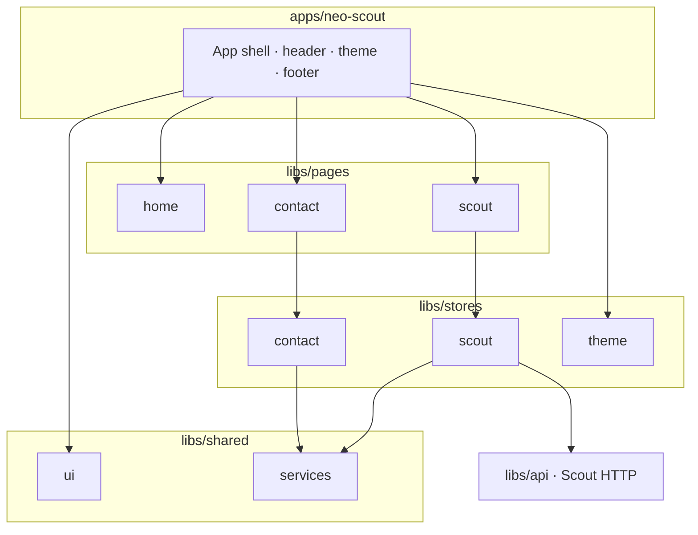

# NEO Scout

Angular + Nx demo app for browsing [NASA/JPL Scout](https://ssd-api.jpl.nasa.gov/doc/scout.html) near-Earth object candidates: search/filter a grid, open candidate detail, and send a simulated contact inquiry.

**Live demo:** [https://vtsitlak.github.io/neo-scout/](https://vtsitlak.github.io/neo-scout/)  
**Source:** [https://github.com/vtsitlak/neo-scout](https://github.com/vtsitlak/neo-scout)

## Prerequisites

- Node.js 22+
- npm

## Run the app

```sh
npm install
npm start
```

Open [http://localhost:4200](http://localhost:4200). In development, Scout API calls go through `/api/scout` (dev-server proxy) to avoid CORS.

Production build:

```sh
npm run build
```

GitHub Pages build (correct `base-href`):

```sh
npm run build:pages
```

## Tests

```sh
# Unit tests (Vitest via Nx)
npm test

# E2E (Playwright) — install browsers once, then run
npm run e2e:install
npm run e2e
```

E2E covers the app shell (nav, theme), Contact submit flow, and Scout search / filters / candidate detail (Scout API is mocked in those tests).

Also available: `npm run lint`, `npm run format:check`.

## Architecture



Lazy routes: `/` (Home), `/scout`, `/contact`. Feature pages talk to SignalStore facades; Scout data comes from `libs/api`.

## Release / deploy

**Branching:** feature work PRs into `develop`. Releases promote `develop` → `main`, then tag.

**Version bumps** (keep in sync):

1. `package.json`
2. `apps/neo-scout/src/app/package-meta.json` (footer version)

Suggested flow:

1. From `develop`, cut `release/vX.Y.Z` (optional but clear).
2. Bump both version files; commit e.g. `Release v1.0.0`.
3. PR → `develop` and merge.
4. PR `develop` → `main` and merge.
5. Tag the merge commit on `main`: `git tag v1.0.0 && git push origin v1.0.0`.

You do **not** need a long-lived release branch beyond the version bump.

**Deploy:** GitHub Actions (`.github/workflows/ci.yml`) runs format, lint, unit tests, build, and Playwright e2e on PRs/pushes to `develop` and `main`. On push to those branches, after quality + e2e pass, it builds with `npm run build:pages` and deploys to GitHub Pages.

## Assumptions & trade-offs

- **Full Scout list client-side** — the public Scout API has no paging; search/filter/sort run in the Scout store over the loaded list.
- **Contact submit is simulated** — no backend; the contact store fakes success/failure for UX demos.
- **Dev proxy for Scout** — production/Pages call the NASA URL directly; local serve uses `/api/scout`.
- **SPA on Pages** — CI copies `index.html` to `404.html` so deep links work on GitHub Pages.
- **Scores are interest flags** — Scout NEO/PHA scores are not rigorous impact probabilities; “hazard interest” in the UI is a simple blend for display.
